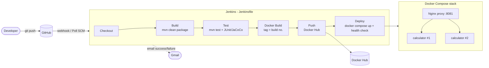

# Calculator REST API — CI/CD with Jenkins, Docker & Docker Compose

CSE 816 Software Production Engineering — Mini-Project.

A small Spring Boot 4 (Java 17, Maven) REST service that adds, subtracts, multiplies and divides two numbers.
The application is intentionally simple; the focus is the automated DevOps pipeline around it.

## API

Base path: `/api/v1`. All operations are `GET` requests that take two numeric query parameters `a` and `b`.

| Operation | Endpoint                         | Behaviour                                  |
|-----------|----------------------------------|--------------------------------------------|
| Add       | `GET /api/v1/add?a=&b=`          | `a + b`                                    |
| Subtract  | `GET /api/v1/subtract?a=&b=`     | `a - b`                                    |
| Multiply  | `GET /api/v1/multiply?a=&b=`     | `a * b`                                    |
| Divide    | `GET /api/v1/divide?a=&b=`       | `a / b`; `b = 0` → **HTTP 400** with error JSON |
| Health    | `GET /actuator/health`           | Spring Boot Actuator probe (`UP` / `DOWN`) |
| Info      | `GET /actuator/info`             | App name, version, environment             |

Numbers are handled as `BigDecimal`, so results are exact (`0.1 + 0.2 = 0.3`). Non-terminating
divisions are rounded to 16 significant digits (`1 / 3 = 0.3333333333333333`).

### Success response

```http
GET /api/v1/add?a=2&b=3
```
```json
{ "operation": "add", "a": 2, "b": 3, "result": 5 }
```

### Error response (HTTP 400)

Returned for division by zero, a missing or empty parameter, or a non-numeric parameter.

```http
GET /api/v1/divide?a=10&b=0
```
```json
{
  "timestamp": "2026-10-30T10:00:00.000Z",
  "status": 400,
  "error": "Bad Request",
  "message": "Division by zero is not allowed: parameter 'b' must not be 0",
  "path": "/api/v1/divide"
}
```

## Build, test and run locally

Prerequisites: JDK 17+ and Maven 3.9+ (or use the bundled Maven wrapper `./mvnw` / `mvnw.cmd`).

```bash
mvn clean package -DskipTests   # compile and build target/calculator.jar
mvn test                        # run all tests (JUnit XML in target/surefire-reports/)
java -jar target/calculator.jar # start on http://localhost:8080
```

Try it:

```bash
curl "http://localhost:8080/api/v1/add?a=2&b=3"
curl "http://localhost:8080/api/v1/divide?a=7&b=2"
curl "http://localhost:8080/api/v1/divide?a=1&b=0"     # 400
curl "http://localhost:8080/actuator/health"
```

## Tests

| Test class                      | Type                         | What it covers                                            |
|---------------------------------|------------------------------|-----------------------------------------------------------|
| `CalculatorServiceTest`         | JUnit 5 unit tests           | Every operation incl. decimals, negatives, divide-by-zero |
| `CalculatorControllerTest`      | `@WebMvcTest` + MockMvc      | JSON shape, 400 for missing/empty/non-numeric/zero input  |
| `CalculatorApiIntegrationTest`  | `@SpringBootTest` + MockMvc  | Full context: real endpoints, actuator health, 404        |
| `CalculatorApplicationTests`    | Context load                 | Application starts                                         |

`mvn test` also produces a JaCoCo coverage report in `target/site/jacoco/index.html`.

## CI/CD pipeline



| Stage        | What it does                                                                                 |
|--------------|----------------------------------------------------------------------------------------------|
| Checkout     | `checkout scm` - pulls the commit that triggered the build                                    |
| Build        | `mvn -B clean package -DskipTests`, archives `target/calculator.jar`                          |
| Test         | `mvn -B test`; publishes JUnit XML and JaCoCo coverage; any failing test fails the build      |
| Docker Build | `docker build` tagged `<user>/calculator-api:<BUILD_NUMBER>` and `:latest`                    |
| Push         | `docker login` with the Jenkins credential `dockerhub-credentials`, then `docker push`        |
| Deploy       | `docker compose up -d --wait` (waits for health checks), then health + smoke test via Nginx   |
| post         | HTML email to the student on success / failure / unstable                                    |

**Trigger:** GitHub push webhook (`githubPush()`), with `pollSCM('H/2 * * * *')` as a fallback.
**Idempotent:** the Compose project name is fixed (`calculator`), so a re-run updates the same stack in place;
re-deploying the same tag is a no-op and a new tag only recreates the API containers.

## Docker

Multi-stage `Dockerfile`:

1. **build** - `maven:3.9-eclipse-temurin-17`: copies `pom.xml` first and runs `dependency:go-offline`
   (cached layer), then copies `src/` and packages the JAR.
2. **runtime** - `eclipse-temurin:17-jre-alpine`: copies **only** the JAR, runs as the non-root user
   `spring`, `EXPOSE 8080`, `HEALTHCHECK` on `/actuator/health`, exec-form `ENTRYPOINT`.

`.dockerignore` keeps `.git`, `target/`, IDE files and secrets out of the build context.

```bash
docker build -t calculator-api .
docker run -d -p 8080:8080 calculator-api
curl "http://localhost:8080/api/v1/add?a=2&b=3"
```

Published image: `docker pull <dockerhub-user>/calculator-api:latest`

## Docker Compose deployment

`docker-compose.yml` runs the full stack with one command:

| Service      | Details                                                                                       |
|--------------|-----------------------------------------------------------------------------------------------|
| `calculator` | the API image, **2 replicas**, env vars, memory limit, health check, `restart: unless-stopped` |
| `nginx`      | reverse proxy / load balancer on host port **8081**, waits for a healthy API, own health check |

Networks: `calculator-frontend` (host -> Nginx) and `calculator-backend` (`internal: true`, Nginx -> API only).
Nginx re-resolves the replicas through Docker DNS, so redeploys never leave it pointing at old containers.
The `X-Upstream-Server` response header shows which replica answered.

```bash
docker compose up -d            # pulls the image from Docker Hub (or builds it) and starts everything
docker compose ps               # both replicas and nginx should be "healthy"
curl -i "http://localhost:8081/api/v1/divide?a=7&b=2"
docker compose down
```

Overridable variables: `DOCKERHUB_USER`, `IMAGE_TAG` (default `latest`), `PROXY_PORT` (default `8081`), `APP_ENV`.

## Jenkins setup (reproducible)

Jenkins itself runs in Docker and is configured entirely as code in [`jenkins/`](jenkins):

| File                   | Purpose                                                                                     |
|------------------------|---------------------------------------------------------------------------------------------|
| `Dockerfile`           | `jenkins/jenkins:lts-jdk21` + Maven, Docker CLI, Compose plugin and the required plugins       |
| `plugins.txt`          | Pipeline, Git, GitHub, Credentials Binding, JUnit, Coverage, Email Extension, JCasC, Job DSL   |
| `casc.yaml`            | Admin user, credentials, Gmail SMTP, global env vars and the `calculator-pipeline` job         |
| `docker-compose.yml`   | Runs Jenkins on :8080 with the host Docker socket; optional Cloudflare tunnel for the webhook  |
| `setup-secrets.ps1`    | Prompts for the passwords/tokens and stores them locally in `jenkins/secrets/` (git-ignored)   |
| `update-webhook.ps1`   | Points the GitHub webhook at the current tunnel URL                                           |

```powershell
cd jenkins
powershell -ExecutionPolicy Bypass -File .\setup-secrets.ps1   # one time
docker compose up -d --build                                    # http://localhost:8080
docker compose --profile webhook up -d                          # public URL for GitHub
powershell -ExecutionPolicy Bypass -File .\update-webhook.ps1
```

**Secrets:** the Docker Hub token and Gmail App Password are stored only as Docker secrets on the
Jenkins host and loaded into the Jenkins Credentials store at start-up. Nothing sensitive is in Git.

## Project structure

```
calculator-devops/
├── src/main/java/com/spe/calculator/
│   ├── CalculatorApplication.java
│   ├── controller/CalculatorController.java
│   ├── service/CalculatorService.java
│   ├── dto/ (CalculationResponse, ErrorResponse)
│   └── exception/ (DivisionByZeroException, GlobalExceptionHandler)
├── src/test/java/com/spe/calculator/   # unit, web-slice and integration tests
├── pom.xml                             # Maven build (+ JaCoCo)
├── Dockerfile                          # multi-stage build
├── .dockerignore
├── docker-compose.yml                  # 2 x API + Nginx proxy
├── nginx/                              # proxy config + image
├── Jenkinsfile                         # declarative CI/CD pipeline
├── jenkins/                            # Jenkins server as code
├── .gitignore
└── README.md
```
